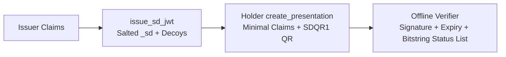

# sdjwt-offline

[](https://github.com/codesphere-u/sdjwt-offline/actions/workflows/ci.yml)
[](LICENSE)
[](pyproject.toml)
[](pyproject.toml)

**Zero-network IETF RFC 9901 Selective-Disclosure JWT (SD-JWT) issuer/verifier, W3C Bitstring Status List offline revocation bitmaps, and compact `SDQR1:` QR credential toolkit.**

- **Mission Domain:** Digital Identity & Privacy-Preserving Trust
- **Stack:** Pure Python 3.11+ (zero runtime third-party dependencies, `mypy --strict`, `ruff`, `pytest`)
- **Maintainer:** Codesphere Innovations (U) Limited (`codesphere-u`)

---

## Problem Solved

Humanitarian voucher programs, academic verification boards, and licensing bodies struggle with forged paper certificates and centralized biometric databases that fail offline and over-expose citizen PII.

## Key Features

- IETF RFC 9901 salted SHA-256 `_sd` claim disclosures with uniform decoy digest mixing.
- Holder selective disclosure (`create_presentation`) revealing only requested claims while keeping hidden claims cryptographically omitted from the wire.
- W3C Bitstring Status List v1.0 zlib-compressed offline revocation bitmaps.
- Compact `SDQR1:` zlib+base64url QR framing and pluggable signer/verifier callables (built-in constant-time HS256 or external Ed25519/ES256).

## Architecture Overview



See [docs/architecture.md](docs/architecture.md) for module-level design details.

## Installation

```bash
git clone https://github.com/codesphere-u/sdjwt-offline.git
cd sdjwt-offline
uv sync --extra dev
```

Or install in editable mode with standard `pip`:

```bash
pip install -e ".[dev]"
```

## Quick Start (CLI)

```bash
sdjwt-offline demo
```

## Quick Start (Python API)

```python
from sdjwt_offline import create_presentation, issue_sd_jwt, make_hmac_signer, verify_sd_jwt

sign, verify = make_hmac_signer(b"0123456789abcdef0123456789abcdef")
cred = issue_sd_jwt(issuer="did:web:uni.edu", subject="s1", public_claims={}, disclosable_claims={"degree": "BSc", "nin": "SECRET"}, sign_fn=sign)
pres = create_presentation(cred, {"degree"})
res = verify_sd_jwt(pres, verify_fn=verify)
assert res.valid and "nin" not in res.disclosed_claims
```

## Testing & Quality Gates

```bash
uv run ruff check src tests
uv run mypy src
uv run pytest -v
```

## Security, Contributing & Roadmap

- **Security:** See [SECURITY.md](SECURITY.md) for responsible disclosure procedures.
- **Contributing:** See [CONTRIBUTING.md](CONTRIBUTING.md) and [CODE_OF_CONDUCT.md](CODE_OF_CONDUCT.md).
- **Changelog & Roadmap:** See [CHANGELOG.md](CHANGELOG.md) and [ROADMAP.md](ROADMAP.md).

## License

MIT License — see [LICENSE](LICENSE).

## Support & Contact

Open an issue on [GitHub Issues](https://github.com/codesphere-u/sdjwt-offline/issues) or contact `codesphereinnovationz@gmail.com`.
